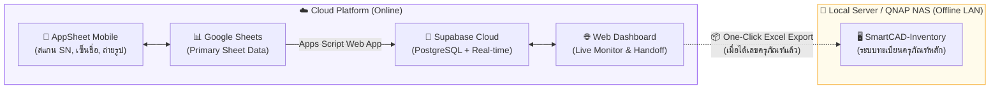

# 🚀 SmartCAD-Lending (ระบบยืม-คืนอุปกรณ์และครุภัณฑ์ใหม่)

> **กองบริหารงานกลาง มหาวิทยาลัยเชียงใหม่ (Central Administration Division, CMU)**  
> ระบบบริหารจัดการการยืม-คืนอุปกรณ์และครุภัณฑ์ใหม่ที่ยังไม่ได้รับเลขครุภัณฑ์ (อ้างอิง Serial Number และหลักฐานภาพถ่าย/ลายเซ็น) เชื่อมต่อแบบไร้รอยต่อระหว่าง **AppSheet**, **Google Sheets**, **Supabase (Cloud)** และส่งต่อเข้าสู่ระบบ **SmartCAD-Inventory (Local Server)**

---

## 🌟 จุดเด่นของระบบ (Key Features)

- **📱 Mobile App (AppSheet)**: สำหรับเจ้าหน้าที่ถือตรวจรับอุปกรณ์ สแกน Serial Number ถ่ายรูปผู้ยืม ถ่ายสภาพอุปกรณ์ และเซ็นชื่ออิเล็กทรอนิกส์
- **⚡ Real-time Web Dashboard**: แดชบอร์ดภาพรวมแบบสด ออกแบบตาม **CMU Brand Identity (สีม่วง มช. + สีทองล้านนา)** พร้อมสไตล์ **Apple Liquid Glass Morphism** รองรับ **Light / Dark Theme**
- **🔄 Auto Status Synchronization**: ปรับปรุงสถานะอุปกรณ์อัตโนมัติ (เช่น ยืม -> `ถูกยืม`, คืน -> `ว่าง`) ผ่าน PostgreSQL Triggers
- **📦 Seamless CAD-Inventory Handoff**: เมื่ออุปกรณ์ได้รับเลขครุภัณฑ์แล้ว สามารถกด **One-Click Export Excel** ที่ฟอร์แมตหัวตารางตรงกับระบบ **SmartCAD-Inventory (Local QNAP / LAN)** 100% ป้องกันข้อมูลชนหรือทับซ้อน

---

## 🏛️ สถาปัตยกรรมการทำงานร่วมกัน (Coexistence Architecture)



---

## 📂 โครงสร้างโฟลเดอร์โปรเจกต์

```text
smart-cad-borrow&new parcel+supabase/
├── index.html                           # 🌐 Web Dashboard (Real-time Live Monitor)
├── supabase_schema.sql                  # 🐘 Database Schema, Triggers, Views & Policies
├── sync_appscript.js                    # 📜 Google Apps Script (Auto-sync Sheets ↔ Supabase)
├── template_sheet_assets.csv            # 📋 โครงสร้างหัวตาราง Assets สำหรับ Google Sheets
├── template_sheet_borrow_transactions.csv# 📋 โครงสร้างหัวตาราง Transactions
├── APPSHEET_BLUEPRINT.md                # 📱 พิมพ์เขียวและวิธีตั้งค่า AppSheet ละเอียดทุกฟิลด์
├── SETUP_GUIDE.md                       # 📖 คู่มือการติดตั้งและเริ่มต้นใช้งานระบบ
├── .env.example                         # 🔒 ตัวอย่างการตั้งค่า Environment Variables
└── .gitignore                           # 🛡️ ป้องกันไฟล์ Secret หลุดขึ้น Git
```

---

## 🚀 วิธีเริ่มต้นใช้งาน (Quick Start)

### 1. ติดตั้ง Database บน Supabase
1. สร้างโปรเจกต์บน [Supabase.com](https://supabase.com)
2. ไปที่เมนู **SQL Editor** คัดลอกเนื้อหาในไฟล์ [`supabase_schema.sql`](./supabase_schema.sql) ไปวางแล้วกด **Run**

### 2. เตรียม Google Sheets & Google Apps Script
1. สร้าง Google Sheets ตั้งชื่อว่า `CAD-borrow&newpacel`
2. สร้าง 2 แผ่นงาน: `assets` และ `borrow_transactions` โดยใช้หัวตารางจากไฟล์ CSV ในโปรเจกต์
3. ไปที่ **Extensions > Apps Script** นำโค้ดใน [`sync_appscript.js`](./sync_appscript.js) ไปวาง และ Deploy เป็น Web App

### 3. เปิดใช้งาน AppSheet
1. เข้าไปที่ [AppSheet.com](https://www.appsheet.com) นำ Google Sheets ดังกล่าวมาสร้างแอป
2. ตั้งค่า Data Types และ Action ตามขั้นตอนใน [`APPSHEET_BLUEPRINT.md`](./APPSHEET_BLUEPRINT.md)

### 4. เปิดใช้งาน Web Dashboard
- สามารถเปิดไฟล์ [`index.html`](./index.html) ผ่านเบราว์เซอร์ได้ทันที หรือนำไปโฮสต์บน **GitHub Pages**, **Vercel**, หรือ **Cloudflare Pages** ได้อย่างง่ายดาย

---

## 👥 สิทธิ์และความปลอดภัย (Security & Privacy)
- รองรับการใช้งานแบบหลายผู้ใช้ (Multi-user) บน AppSheet โดยแชร์สิทธิ์ `can use app`
- ควบคุมการเข้าถึงข้อมูลผ่าน **Supabase Row Level Security (RLS)**

---

## 📄 ลิขสิทธิ์ (License)
โครงการนี้พัฒนาขึ้นสำหรับ **กองบริหารงานกลาง มหาวิทยาลัยเชียงใหม่ (CMU)**  
สงวนลิขสิทธิ์ © 2026 กองบริหารงานกลาง มหาวิทยาลัยเชียงใหม่
